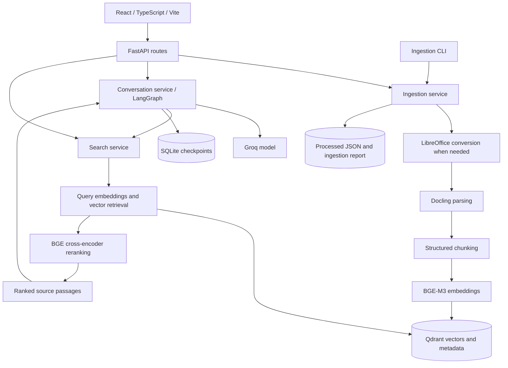

# ISO Knowledge Assistant

A document-grounded assistant for searching an ISO library and asking follow-up
questions. It retrieves relevant passages and produces natural Markdown answers
with citations. Ambiguous questions pause for clarification; insufficient evidence
triggers a bounded retrieval retry or an explanation of the gap.

Parsing, embeddings, vector storage, and reranking run locally. Chat uses Groq for
query analysis, evidence checks, and answer generation, sending relevant passages
and conversation context to the configured model. Search and ingestion need no Groq key.

## Requirements

- Python 3.12+ and uv, or Python venv and pip.
- Node.js and npm for the frontend.
- Docker Desktop for Qdrant, or embedded Qdrant.
- LibreOffice for legacy Office and Visio conversion.
- Groq API key for chat.

## Setup

The repository has two independent projects: `backend/` (Python) and
`frontend/` (React). Run the backend commands from `backend/` in PowerShell:

```powershell
cd backend
uv venv .venv
uv pip install --python .venv/Scripts/python.exe -r requirements.txt
if (!(Test-Path .env)) { Copy-Item .env.example .env }
```

Without uv, use `py -3.12 -m venv .venv` followed by
`.\.venv\Scripts\python.exe -m pip install -r requirements.txt`. On Linux/macOS
use `.venv/bin/python`; on Linux without a GPU, install CPU wheels first:
`python -m pip install torch torchvision --index-url https://download.pytorch.org/whl/cpu`.

Edit `backend/.env`: set `GROQ_API_KEY` and `DOCUMENT_DIR`. Relative paths in it
resolve from `backend/`. The default library is
`ISO 9001 Full Documents`. If needed, set
`LIBREOFFICE_PATH=C:/Program Files/LibreOffice/program/soffice.exe`.
Keep existing credentials when upgrading. If you used the earlier layout with
everything at the repository root, move `.env`, `data/`, `.cache/`, and your
document folder into `backend/`.

Start Qdrant with Docker Desktop running (from `backend/`):

```powershell
docker compose up -d qdrant
```

Alternatively set `QDRANT_PATH=data/qdrant-local` in `backend/.env` for embedded storage
without Docker. Embedded mode permits one process: stop the backend before CLI
ingestion. In either mode, use one writer and avoid API queries during a CLI rebuild.

## Run the project

Steps 1 and 2 run from `backend/`.

### 1. Index documents

```powershell
.\.venv\Scripts\python.exe -m app.ingest
```

Unchanged successful files are skipped. Optional targeted ingestion or rebuild:

```powershell
.\.venv\Scripts\python.exe -m app.ingest --folder '2 - Procedures - SOPs'
.\.venv\Scripts\python.exe -m app.ingest --force
```

First use downloads large BGE weights and may download Docling layout/OCR models.
Allow sufficient RAM, disk space, and time. Models load lazily and default to CPU.
Successful documents are retained if other files fail; ingestion exits nonzero
when failures occur.

### 2. Start the backend

```powershell
.\.venv\Scripts\python.exe -m uvicorn app.main:app --host 127.0.0.1 --port 8009 --http h11 --ws none
```

Use a single worker. The supported backend entry point is `app.main:app`.

### 3. Start the frontend in another terminal

```powershell
cd frontend
if (!(Test-Path .env)) { Copy-Item .env.example .env }
npm.cmd ci
npm.cmd run dev
```

`frontend/.env` sets `VITE_API_PROXY_TARGET` (backend URL, default
`http://127.0.0.1:8009`) and `VITE_DEV_PORT` (default `5173`). If you change the
port, add the new origin to `CORS_ORIGINS` in `backend/.env`.

- Chat: http://127.0.0.1:5173
- API documentation: http://127.0.0.1:8009/docs
- Health: http://127.0.0.1:8009/health

Vite forwards `/api` requests to the backend. Restart the backend after changing
Python code or `backend/.env`.

## Architecture



**Ingestion:** SHA-256 identifies documents. Files are converted when needed,
parsed, and split into structured chunks. BGE-M3 embeds chunks into Qdrant.
The service tracks source metadata, duplicate content, changes, and file failures.

**Chat:** LangGraph routes small talk directly. Document questions go through
query analysis, optional clarification, query expansion, retrieval, deduplication,
rank fusion, and reranking. An evidence check gates answer generation. Insufficient
evidence can trigger a retrieval retry. Supporting passages feed the answer prompt;
citation numbers are validated before automatic publication.

**State:** SQLite persists conversations and clarification pauses. Conversation
operations are serialized; ingestion and search share another lock. The application
is designed for local use with one backend worker.

## Project structure

```text
README.md
.github/workflows/          Backend and frontend CI/CD pipelines
backend/                    Python project (run backend commands here)
  app/
    main.py                 FastAPI assembly and resource lifecycle
    api/
      dependencies.py       Typed HTTP service dependencies
      routes/               System, chat, document, and search endpoints
    core/                   Settings, logging, pipeline errors
    models/                 API request and response schemas
    services/               Conversation, ingestion, search, index facade, wiring
    conversation/           Graph topology, prompts, state, decision schemas
    ingestion/              Conversion, parsing, metadata, chunking
    embeddings/             BGE-M3 embedding adapter
    retrieval/              Vector retrieval and BGE reranking
    vectorstore/            Qdrant persistence adapter
    utils/                  Shared file, text, and cleanup helpers
    ingest.py               Ingestion CLI (python -m app.ingest)
  tests/                    API, graph, ingestion, retrieval tests
  data/                     Generated artifacts and persisted state
  pyproject.toml            Python dependency definitions and package metadata
  requirements.txt          Generated dependencies and editable install
  compose.yaml              Local Qdrant service
  .env.example              Backend configuration template
  Dockerfile                Production image (CPU PyTorch, LibreOffice, non-root)
  deploy/                   Server compose stack and server .env template
frontend/                   React / TypeScript / Vite project
  src/
    app/                    App root, layout shell, view switching
    api/                    Typed API client and response types
    components/             Shared UI: sidebar, header, markdown, notices
    features/chat/          Conversation hook, chat view, composer, sources
    features/library/       Library hook, file list, filters
    hooks/ lib/             Health hook; citation, storage, and small helpers
    styles/                 Design tokens (light/dark) and base styles
  .env.example              Frontend configuration template
  deploy/                   Nginx site example (static files + /api proxy)
```

All backend code lives in `backend/`; all frontend code lives in `frontend/`. Qdrant is the single
supported vector store; compatibility wrappers and the alternate Chroma pipeline
have been removed. `pyproject.toml` defines dependencies; `requirements.txt` lists the application and test dependencies generated from
that metadata, plus the editable project install.

## Configuration

| Setting | Default / purpose |
| --- | --- |
| `GROQ_API_KEY` | Required for chat |
| `GROQ_MODEL` | `openai/gpt-oss-120b` |
| `DOCUMENT_DIR` | `ISO 9001 Full Documents` |
| `DATA_DIR` | `data` |
| `QDRANT_URL` | `http://localhost:6333` |
| `QDRANT_PATH` | Empty for server mode; set for embedded storage |
| `EMBEDDING_MODEL` | `BAAI/bge-m3` |
| `RERANKER_MODEL` | `BAAI/bge-reranker-v2-m3` |
| `MODEL_DEVICE` | `cpu` |
| `MODEL_CACHE_DIR` | `.cache/huggingface/hub` |
| `MODEL_LOCAL_FILES_ONLY` | `false`; enable after caching BGE weights |
| `CHUNK_MAX_TOKENS` | `500` |
| `VECTOR_SEARCH_LIMIT` / `FINAL_RESULT_LIMIT` | `20` candidates per query / `5` final results |
| `MULTI_QUERY_LIMIT` | `3`, including the original query |
| `RETRIEVAL_MAX_RETRIES` | `1` |
| `GRAPH_STRUCTURED_OUTPUT_METHOD` | `json_schema` |
| `CORS_ORIGINS` | `http://localhost:5173,http://127.0.0.1:5173` |

See `backend/.env.example` for all options. Use a new Qdrant collection when changing
incompatible embedding or chunk settings. Docling models have separate caching needs.

## API

Document/search routes support both unprefixed paths and `/api` aliases.

| Method | Path | Purpose |
| --- | --- | --- |
| GET | `/health` | Liveness and configuration |
| GET | `/api/documents` | Report and library inventory |
| POST | `/documents/ingest` | Upload multipart `file` |
| POST | `/documents/ingest-folder` | Ingest a folder inside `DOCUMENT_DIR` |
| GET / DELETE | `/documents/{document_id}` | Inspect / remove document vectors |
| POST | `/search` | Return ranked chunks without an answer |
| POST | `/api/threads` | Create a conversation ID |
| GET | `/api/threads/{id}` | Read conversation and sources |
| POST | `/api/threads/{id}/messages` | Ask a question |
| POST | `/api/threads/{id}/clarify` | Reply to clarification |

Example search body:

```json
{
  "query": "How is documented information controlled?",
  "top_k": 5,
  "filters": {"document_type": "procedure"}
}
```

Chat accepts `{"question":"How is documented information controlled?","category":""}`.
Clarification accepts `{"answer":"Supplier evaluation"}`. Search scores are reranker
logits, not confidence probabilities. The legacy `/review` endpoint remains for
compatibility; new answers do not wait for approval.

## Verification

```powershell
cd backend
.\.venv\Scripts\python.exe -m pytest -q
cd ..\frontend
npm.cmd run typecheck
npm.cmd run lint
npm.cmd run test
npm.cmd run build
```

Regular tests use deterministic embedding/LLM substitutes with real Docling and
embedded Qdrant. Citation checks validate source numbers, not whether every claim
follows from its cited passage. Live answer quality needs separate evaluation.

Optional checks from `backend/`:

```powershell
# Downloads/loads actual BGE model weights.
$env:RUN_MODEL_TESTS = '1'
.\.venv\Scripts\python.exe -m pytest tests/test_real_models.py -q
Remove-Item Env:RUN_MODEL_TESTS

# Calls Groq with synthetic passages and consumes API quota.
$env:RUN_GROQ_TESTS = '1'
.\.venv\Scripts\python.exe -m pytest tests/test_live_graph.py -q
Remove-Item Env:RUN_GROQ_TESTS
```

## Deployment (backend CI/CD)

`.github/workflows/backend.yml` runs on every push to `main` that changes `backend/**`
(or manually via **Run workflow**):

1. **test** — installs CPU PyTorch and `backend/requirements.txt`, runs `pytest`.
2. **build** — builds `backend/Dockerfile` natively on amd64 and arm64 runners and pushes
   each by digest to `ghcr.io/harshavanteru/iso-agent-backend`.
3. **merge** — publishes one multi-arch image tagged `latest` and the commit SHA.
4. **deploy** — copies `backend/deploy/compose.yaml` to the server, pulls the SHA-tagged
   image, restarts the `backend` service, and fails the run (printing logs) unless the
   container reports healthy within three minutes.

**Repository secrets** (Settings → Secrets and variables → Actions):

| Secret | Value |
| --- | --- |
| `SERVER_HOST` / `SERVER_USERNAME` | SSH host and user of the deploy server |
| `SERVER_SSH_KEY` | Private key for that user |
| `GHCR_USERNAME` / `GHCR_PAT` | GitHub user and a token with `read:packages`, used by the server to pull |

**One-time server setup** (Docker with the Compose plugin installed):

```bash
sudo mkdir -p /var/www/html/iso-agent/documents
sudo chown -R "$USER" /var/www/html/iso-agent
cd /var/www/html/iso-agent
# Create .env from backend/deploy/.env.example and set GROQ_API_KEY and CORS_ORIGINS.
```

Copy the ISO library into `/var/www/html/iso-agent/documents/` (mounted read-only),
then index it after the first deploy:

```bash
cd /var/www/html/iso-agent
docker compose run --rm backend python -m app.ingest
```

The API listens on `127.0.0.1:8009` (`BACKEND_PORT` in `.env`); publish it through the
server's reverse proxy. Models download into the `model_cache` volume on first use.

**Rollback:** re-run an earlier successful workflow, or on the server run
`BACKEND_TAG=<previous commit sha> docker compose up -d --no-deps backend`.

## Deployment (frontend CI/CD)

`.github/workflows/frontend.yml` runs lint, type-check, tests, and a production build on
pull requests and pushes to `main` that change `frontend/**`. On `main` it then rsyncs
`frontend/dist` to the server (files are swapped in at the end, so visitors never see a
half-uploaded site), optionally purges Cloudflare, and smoke-tests the live site.

The app calls the API on its own origin (`/api`), so Nginx serves the site and proxies
`/api/` to the backend on `127.0.0.1:8009`. Start from
`frontend/deploy/nginx.conf.example` (set `server_name`, add TLS, `sudo nginx -t`,
reload). No build-time API URL and no CORS configuration are needed.

It reuses `SERVER_HOST`, `SERVER_USERNAME`, and `SERVER_SSH_KEY` from the backend, plus:

| Name | Kind | Purpose |
| --- | --- | --- |
| `SERVER_PORT` | secret | SSH port (default `22`) |
| `SERVER_SSH_KNOWN_HOSTS` | secret | Pinned host key (`ssh-keyscan -H <host>`); otherwise scanned at deploy time |
| `FRONTEND_DEPLOY_PATH` | variable | Default `/var/www/html/iso-agent/frontend` |
| `FRONTEND_URL` | variable | Public URL; enables the smoke test of `/` and `/api/health` |
| `RELOAD_NGINX` | variable | `true` to reload Nginx after deploy (needs passwordless `sudo systemctl reload nginx`) |
| `CLOUDFLARE_API_TOKEN` / `CLOUDFLARE_ZONE_ID` | secrets | Optional cache purge |

The deploy job uses the `production` environment, so you can add required reviewers to it
under Settings → Environments.

## Troubleshooting

- Chat unavailable: set `GROQ_API_KEY` in `backend/.env` and restart.
- No indexed documents: run ingestion and inspect per-file errors.
- Qdrant connection failure: start Qdrant or configure embedded storage.
- Embedded storage locked: stop the other backend/ingestion process.
- Citation failure: inspect cited/allowed IDs and finish reason in backend warnings.
- Legacy conversion failure: verify the LibreOffice installation and configured path.

Keep the server bound to localhost: authentication and multi-user deployment are
not implemented.

## Editing assistant prompts

Edit `backend/app/conversation/prompts.py` to change routing, query analysis,
query expansion, evidence checks, answer style, or citation repair instructions.
`ANSWER_GENERATION` controls how document answers are framed. Preserve template
placeholders such as `{allowed_citations}`, `{passages}`, and `{variant_limit}`.
`nodes.py` supplies these values and executes the workflow. Restart the backend
after editing prompts.

## Git file policy

Commit source code, tests, README, configuration files, `.env.example`, dependency
manifests, and `frontend/package-lock.json`. Keep real credentials out of templates.

`.gitignore` excludes the private ISO library, `data/`, model caches, virtual
environments, `node_modules/`, builds, databases, logs, and local editor settings.
If `DOCUMENT_DIR` points to another directory inside this repository, add it to
`.gitignore` before staging. Ignoring a file does not untrack an existing commit.

Review what Git would include before staging:

```powershell
git status --short
git ls-files --others --exclude-standard
```

## Document processing and storage

Supported formats: PDF, DOCX, DOC, XLSX, XLS, PPTX, TXT, CSV, Markdown, VSD,
and VSDX. Legacy Office files and Visio diagrams use LibreOffice conversion.
Original files are preserved. On Windows the converter prefers `soffice.com`
when available and uses short temporary profile paths under `backend/data/.office-work/`.

HybridChunker uses the embedding tokenizer with a default 500-token budget.
Small forms remain whole where possible; presentations retain slide locations;
spreadsheet chunks preserve sheet information and repeat table headers.
If Docling produces no PDF chunks, the pipeline tries the pypdf text layer and
marks recovered chunks with `extractor=pypdf_text_fallback`. Extraction does not
guarantee diagram relationships, SmartArt, embedded objects, or formula semantics.
Review representative extracted content before relying on answers.

| Location | Contents |
| --- | --- |
| `backend/data/raw/` | API uploads |
| `backend/data/processed/<document_id>/` | Converted/parsed artifacts and chunk previews |
| `backend/data/qdrant-ingestion.json` | Per-file ingestion status and source tracking |
| `backend/data/conversations-legacy.sqlite` | Conversation checkpoints; filename retained for existing history |
| `backend/.cache/huggingface/hub/` | Default BGE model cache |

Identical document bytes share a SHA-256 identity. Changed files replace prior
vectors; removed sources are reconciled during successful folder ingestion.
Failed files can be retried without rebuilding unchanged successful documents.
Database/model failures stop ingestion while keeping completed documents.
CLI exit codes are 0 for success, 1 for failures, and 130 for cancellation.
There is no whole-run rollback.

## Conversation behavior

Document questions follow this sequence:

1. Route the message and resolve the question using conversation context.
2. Ask a targeted clarification if needed; persist and wait for the reply.
3. Expand the standalone query into bounded search variants.
4. Retrieve, deduplicate, fuse ranks, and rerank candidates.
5. Check whether passages contain enough evidence; reformulate and retry within
   `RETRIEVAL_MAX_RETRIES` when evidence is insufficient.
6. Generate an answer from supporting passages, validate citation numbers, and
   publish automatically. Citation repair retries generation once.

`MULTI_QUERY_CANDIDATE_LIMIT` defaults to 40 merged candidates;
`CLARIFICATION_MAX_ROUNDS` defaults to 2. The structured output method can be
`json_schema`, `json_mode`, or `function_calling` depending on model support.
Malformed decisions fail the request rather than bypassing the evidence check.

Reply to a pending clarification before sending a new question in that thread.
SQLite checkpoints preserve clarification pauses across restarts. Thread responses
include `workflow_steps`, `search_queries`, `retrieval_attempts`, and
`evidence_sufficient` for diagnosis. After a failed or incompatible checkpoint,
start a new conversation. Model routing and evidence judgments can make mistakes;
evaluate representative questions against their expected source documents.


## LangSmith tracing

Set these in `backend/.env` (or the deployment `.env`) and restart the backend:

```dotenv
LANGSMITH_TRACING=true
LANGSMITH_API_KEY=your-langsmith-api-key
LANGSMITH_PROJECT=iso-agent
LANGSMITH_ENDPOINT=https://api.smith.langchain.com
# Only needed for keys associated with multiple workspaces:
LANGSMITH_WORKSPACE_ID=
```

Open the `iso-agent` project in LangSmith after sending a new question. Native
LangGraph instrumentation creates one parent run per graph invocation with nested
node and Groq runs. The `thread_id` metadata groups follow-ups. No additional
`traceable` wrapper or explicit tracer callback is installed, avoiding duplicate
instrumentation. Stream progress events and health polling are not separately traced.
Retries are separate attempts within the trace. Traces include questions, retrieved
passages, and generated answers. Leave `LANGSMITH_TRACING=false` to disable uploads.
